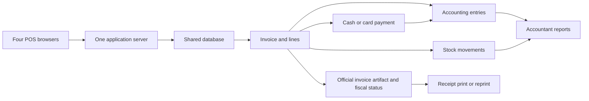

# Store POS and accounting MVP

Updated: 5 October 2026. Status: agreed MVP scope with proposed business rules. The foundation and a development-only sale/stock/payment journal slice exist; current implementation boundaries are in [README](../README.md). This document owns product behavior and acceptance outcomes. Read [Engineering guide](engineering-guide.md) for implementation structure and [AGENTS.md](../AGENTS.md) for working instructions.

## Agreed target

Build a simple web platform that cashiers use directly on the store's POS devices. Each cashier signs in, scans products, takes payment and issues an invoice. The accountant sees the same transaction centrally, with connected stock and money records.

| Requirement | Current decision |
| --- | --- |
| Opening date | 1 November 2026, interpreting the supplied 1/11/2026 |
| Simultaneous POS devices | Four |
| Connectivity | Online-only first release accepted |
| Country | Saudi Arabia |
| Official invoices | New platform must issue them at launch |
| VAT registration | Confirmed by owner; company has a VAT number |
| Phase 2 notice / deadline | Company-specific details unverified; plan for integration capability |
| Hardware | Reported Marvel POS, Bixolon receipt printer, Symbol scanner; exact models/OS/interfaces unverified |
| Product priority | Reliable everyday operations, simple screens |
| Language and direction | Arabic RTL; write Arabic UI directly, no translation pipeline |
| Design approach | Plain usable interface, shared theme tokens and components; visual refinement later |
| Delivery approach | Small complete slices, pragmatic abstractions and focused verification |

Proposed defaults: one store, SAR and Asia/Riyadh business dates. Confirm a default when it affects the current slice. Arabic RTL and the engineering priorities above are owner decisions.

## What the current work actually involves

Sources: [Current spreadsheet](https://docs.google.com/spreadsheets/d/11VzNasMIBKpGtI2RGUZqFPv7-7MK2Ddu9IFaQbjgxw4/edit?gid=795389534#gid=795389534) and [Technolink](https://0563638246.technolinkapp.com/Home). Detailed screen evidence is in [Reference review](reference-system-review.md).

The spreadsheet is a register of outgoing payments and store preparation spending, with supplier summaries and employee advances. It is not an operating POS or a complete profit-and-loss ledger. Your accountant work includes documenting payments, collecting supporting invoices, classifying spending, tracking who funded it, settling employee advances and producing summaries.

| Spreadsheet tab | Existing role | Replacement behavior |
| --- | --- | --- |
| السجل | One row per outgoing payment: internal reference/date, external document, beneficiary/tax ID, description/category, paid/tax/net, funding source, method, payer, review status, notes, alerts | Document + linked payment + evidence + review state |
| الموردون | Supplier identities and derived totals | Supplier master and statement; external reference separate from internal ID |
| العهد | Employee money handed out/returned, spending and balance | Advance movements linked to actual employee-funded documents |
| القوائم | Categories, document types, funding sources, methods, review states | Controlled settings using stable IDs |
| الملخص | Monthly payment/category totals | Derived reports |
| لوحة المعلومات | Overall totals and outstanding review/advance indicators | Dashboard from the same underlying records |
| كشف المصروفات | Printable spending statement | Export/print view |
| طريقة الاستخدام | Evidence, numbering and reconciliation process | Retain this working discipline inside the application |

Observed snapshot: 83 payment records totaling SAR 555,512.86. Categories include rent, repairs, labor, government fees, hospitality, store setup materials, transport, fuel, equipment/assets, resale stock and software subscriptions. This total is outgoing payments, not a calculated operating expense total or profit.

The sheet's workflow calls for an internal reference written on the paper, a corresponding receipt image in a monthly folder, missing evidence marked for review, weekly employee/review checks and monthly reconciliation. Attachments and an unresolved-document queue therefore belong in the MVP.

Separate these actors: the logged-in recorder, the supplier/beneficiary, the actual payer, and the employee holding an advance. They may be different people.

## Core screens

1. **POS:** barcode/search, basket, quantities, cash/card/split payment, change, invoice printing, lookup/reprint and controlled returns.
2. **Products and stock:** names, barcodes, selling units/prices, tax category, receipts, stock count and adjustments.
3. **Purchases and suppliers:** supplier bills, goods received, outstanding balances, payments and returns.
4. **Expenses and money:** evidence, categories, funding account, payment method, transfers, employee advances and reimbursement.
5. **Reports:** daily sales by cashier/device/payment method, cash reconciliation, stock, supplier balances, spending and employee balances; tax summaries with document traceability.
6. **Settings:** company/fiscal information, users/roles, four POS stations, cash/bank/card-clearing accounts and printing.

Suggested roles: cashier, accountant and owner/manager. Enforce permissions on the server. Cashiers must not change tax settings, costs, opening balances or issued invoices. Return/discount permissions need explicit limits.

Defer appointments, loyalty, SMS, service tickets, complex promotions, branch transfers and wholesale/delivery modes unless the actual opening workflow requires them. Offline selling is excluded by the owner's decision. Unit conversions, weighed goods and expiry requirements still need confirmation; do not defer something used by the opening catalogue.

## Sale: scan to central records

The reference POS visibly offers item-code entry, touch controls, waiting baskets, cash/credit/prepaid invoice types and a cash/card payment dialog with multiple payment rows, tendered amount and change. Physical scanning, payment execution and printing were not tested.

Proposed workflow:

1. Cashier signs in at an assigned POS station and opens a session with a cash float.
2. A scan resolves a barcode to a product and selling unit. Unknown codes show a clear error; cashier can search manually. Confirm the Symbol device's input mode on the actual hardware.
3. Basket displays product, unit, quantity, price, discount, tax and total. Repeated scans increase quantity. Price changes obey permissions. Hold/resume a basket without issuing an invoice or moving stock.
4. Cashier chooses cash, card or split tender. Cash change is calculated separately from the amount applied to the invoice. A card selection records a payment; it must not claim that the external terminal approved a charge unless an integration actually verifies it.
5. Server validates authoritative prices/taxes/permissions and availability rules, assigns document identity and commits related business records once. The fiscal issuance process follows the applicable Phase 1/2 design.
6. Display confirmed invoice identity and printable artifact. A printer failure allows reprinting that invoice; it must not create another sale. Reprinting does not prove the first print succeeded.
7. Accountant sees the sale in the central list and can trace its payments, tax, cashier/session and stock movements.

Online-only means no final sale confirmation without the server. If a response is lost after a successful save, the station must query/retry using the same operation ID and recover the existing invoice. Preserve the basket and show the state clearly. Do not ask the cashier to blindly repeat a card charge.

Four devices require shared invoice identity, isolated cashier sessions and database concurrency control. Confirmed on 5 October 2026: block a sale exceeding recorded available stock until stock is corrected. There is no cashier override. Four independent database connections competing for the last unit must commit only one sale.

## Documents and their effects

These are proposed replacement posting rules, not a claim about Technolink internals. A document and the movement of money are distinct records, even when one screen creates both.

| Document / action | Stock effect | Money / accounting effect |
| --- | --- | --- |
| Sales invoice / فاتورة بيع | Reduce delivered quantities | Record revenue/tax and cash/card receipt or customer receivable |
| Sales return and credit note / مرتجع بيع | Increase only restockable returned goods | Reverse applicable sale/tax; refund or reduce customer balance |
| Supplier bill / فاتورة مشتريات | Increase received quantities | Record inventory or relevant asset/expense and supplier liability |
| Supplier payment / سند صرف للمورد | None | Reduce cash/bank and supplier liability; no second purchase |
| Supplier return | Reduce goods sent back | Reduce supplier balance or record supplier refund receivable; actual refund is separate |
| Operating expense / مصروف | None for non-stock purchases | Record classified cost/tax and funding/payment or payable |
| Equipment purchase / أصل | No resale stock | Record asset and payment/payable; do not automatically expense full cost |
| Rent paid in advance | None | Payment plus reviewed prepaid/expense treatment; not automatically all one month's expense |
| Customer receipt / سند قبض | None | Reduce customer debt and increase money; no second sale |
| Internal transfer / تحويل داخلي | None | Move between money accounts; no revenue or expense |
| Employee advance / تسليم عهدة | None | Move company money into employee custody; no expense yet |
| Expense funded from an advance | As relevant to purchase type | Record expense/asset/inventory once and reduce employee-held money |
| Advance return or employee reimbursement | None | Settle employee balance; do not record original expense again |
| Stock correction / تسوية مخزون | Increase/decrease with reason | Record approved stock adjustment and appropriate value effect |

Tax invoice, non-tax receipt, signed disbursement voucher and bank transfer proof are different evidence types. A bank transfer proof establishes a money movement; it does not replace the supplier invoice or establish deductible tax. A POS receipt is the customer's printed view of the issued sale document. A goods-receipt record tracks physical stock, not incoming customer money.

For expenses, retain the spreadsheet's internal ID, external document reference, date, beneficiary, description, classification, printed tax evidence, funding source, payment method, actual payer, review status, notes and attachment. Tax eligibility and asset/prepayment classification require reviewed rules, not just a category dropdown.

## Supplier records

Implemented: owner/accountant can create, search, edit and deactivate suppliers; cashiers cannot access the register. A supplier requires a name. Tax number, commercial registration, phone, city and notes are optional, following the spreadsheet's supplier fields. Unknown details remain null; a missing tax number does not establish that a supplier is unregistered. Contact fields do not verify tax eligibility.

Each supplier has a stable internal ID and recorded creator/last editor. Editing or deactivating preserves that identity; there is no delete action. Contact maintenance creates no purchase bill, payment, stock movement, journal or opening balance. Supplier document/payment totals derive from linked transactions as those workflows are added, rather than editable contact totals. Bill registration retains supplier snapshots so contact edits cannot rewrite saved documents.

## Supplier bill registration

Implemented first purchase checkpoint: owner/accountant can register a wholly unpaid supplier bill using its external document reference, date, description, positive printed gross total and optional printed tax. This is document-header registration; goods lines, stock receipt and final classification are later slices. Subsequent payments and [private evidence](#document-evidence) use linked workflows. Staff must verify the bill has not been paid or already included in another record/opening balance. Paid or partially paid historical spending needs reconciliation, rather than entering its whole gross amount as new debt.

The server validates cent precision, positive total, tax between zero and total and a date no later than today. Unknown printed tax remains null; verified zero stays zero. Neither supplier registration nor entered printed tax establishes input-tax eligibility. Bill amounts come from the supplier document, not the retail catalogue or a guessed tax rate.

The bill, supplier snapshot and balanced journal commit atomically: debit the temporary **مشتريات بانتظار التصنيف** account for gross and credit **ذمم الموردين** for gross. The temporary account holds amounts for review; it does not establish inventory value, operating expense, an asset's final classification or deductible VAT. Reclassification needs its own linked reviewed posting when those rules exist. Registering a bill creates no stock movement or payment. A later receipt/payment must link the original bill and avoid recording the purchase again. The list is a register of new known bills, not a verified historical supplier balance.

An operation UUID recovers the exact saved attempt, including after supplier deactivation. Changed data or another actor with the same UUID is rejected. New bills require an active supplier. A supplier's document reference can be recorded once, compared without case or surrounding spaces; duplicate attempts are rejected under a supplier lock and database uniqueness constraint. If a supplier reuses an external reference, review its identity before registration rather than inventing a new number to bypass the check. Saved bills have no edit/delete action; linked financial corrections remain future work. Contact changes affect future snapshots only.

## Linked supplier payments

Implemented: owner/accountant can record an actual partial or full payment against an existing bill. Required fields are payment date, positive cent amount, method (company bank or main company cash reserve), payment-proof reference, funding-source reference and actual payer. The recorder remains the authenticated user; the actual payer is recorded separately. Staff must confirm payment actually occurred from company funds. This records an outcome; the application does not send money. Personal funds, employee advances, cashier drawers, prepayments and card payments are outside this checkpoint.

The server locks the bill, calculates paid and remaining amounts from linked payments, and rejects payment above the remainder. Payment date cannot precede the bill or exceed today. A payment and its journal commit atomically: debit supplier payable, credit company bank or main cash reserve. It creates no new purchase, expense, tax or stock movement. The original bill and its gross/printed-tax values stay unchanged. Inactive suppliers can still have existing bills settled.

The same operation UUID recovers the original payment, including after the bill is fully paid. Changed payloads, another actor or another bill with that UUID are rejected. A proof reference is unique per bill/payment method, compared without case or surrounding spaces. Saved payments are read-only; linked correction/refund workflows remain unfinished. Bill pages and lists derive their paid/remainder figures on the server, rather than editable totals; concurrent allocations cannot overpay the same bill.

Cash-reserve and bank opening balances remain unverified. The bank ledger aggregates recorded company bank movements; each payment retains its funding-source reference. Do not present these movements as verified available cash, a bank statement or a reconciled historical balance. Recording an already completed payment does not authorize another transfer. Actual bank/source identities, opening balances and practical reconciliation still need verification before operational accounting.

## Document evidence

Implemented for supplier bills and their separately recorded payments: owner/accountant can add and download private PDF, JPEG or PNG files up to 2 MiB each. The server checks actual MIME type and size. Bills offer invoice, non-tax document and other evidence types; payments offer bank proof, cash voucher and other. Choosing a label does not verify the contents or input-tax eligibility. Attaching evidence changes no document amount, payment, journal or stock quantity.

Each attachment preserves its original name, source record, recorder, timestamp and optional paper location. Unknown paper location stays null. Files are retained without edit/delete actions. Uploading identical bytes again to the same source returns the original attachment and metadata; attaching them to another source remains a separate link. Download requires the owner/accountant permission, and storage paths are not exposed. Missing bytes produce an unavailable-file response, retaining the metadata for recovery.

Private files and database metadata need coordinated backup and restoration. File storage is not part of the database transaction: a known failed insert removes its file; an uncertain commit keeps private bytes until its outcome can be established. This prevents deleting a successfully recorded attachment after a lost response. Restoring these files and completing a missing-evidence review queue remain operational work.

## Employee advances: avoid double counting

Maintain employee movements and spending links, using IDs instead of matching employee names in text.

`Employee balance = money handed to employee − money returned − approved purchases paid from that advance`

Positive means the employee still holds company money. Negative means the company owes reimbursement, subject to approved evidence.

Fictional example: hand over SAR 1,000, then approve SAR 300 of receipts. There is SAR 700 left with the employee and only SAR 300 recorded as spending. Return SAR 700 to company cash and the balance becomes zero. Reimbursing an employee's previously recorded purchase settles the amount owed; it does not create another expense.

A direct employee payment without an advance is recorded as company spending plus an amount owed to that employee. Do not silently create an advance because a payer's name appears in the register. This distinction exists in the current sheet.

## Cashier close and returns

Observed drawer opening fields: date, user, branch and opening amounts by cash/card method. The visible list contained no drawers; closing behavior was not verified.

Implemented development close: the cashier opens a shift on an active station with counted opening cash, then closes it with counted cash and an optional note. One open shift per cashier and per station is enforced. Each new sale belongs to that cashier's exact open shift. Cashiers view and close their own shifts; owner/accountant can view all shifts. Closing saves sale count, sales total, cash/card allocations, cash transfers in/out, expected cash, counted cash and signed variance. Expected cash is **opening cash + cash allocated to sales + cash transferred in − cash transferred out**, excluding customer change. Positive variance is excess; negative is shortage. Earlier sales remain unassigned and do not enter a new shift's totals.

Opening cash is a counted baseline only. Opening/closing creates no income, cash transfer or variance journal. Card receipts remain in the sales card-clearing account; shift closing does not settle them. Closed records cannot be edited through the application. Identical closing retries return the saved result; a changed count/note is rejected. Sale posting and closing serialize on the station, so a racing sale either enters the closing total or is rejected. A committed sale can still be recovered after closing.

Owner/accountant can record actual cash transfers between an open shift's drawer and the store's main cash reserve. Required fields are direction, positive amount, reference and reason; the record also retains actor/time and operation identity. A transfer and its balanced cash/reserve journal commit together. It creates no sale, VAT, expense, supplier payment or stock movement. Cashiers can read their own shift's transfers but cannot record them or read the financial journal. Saved transfers are read-only; mistakes require a separately referenced opposite transfer while the shift is open, rather than editing history.

The server rejects a drawer withdrawal above its expected cash. The main reserve's available balance is not yet established; the operator must verify the physical cash before recording a transfer. These journals do not establish complete cash-account balances until verified financial opening balances are recorded. Counted opening cash remains a baseline, not a transfer to record again. To record cash subsequently supplied from the reserve, open the shift with its actual pre-transfer cash and record that transfer once.

Transfer posting and closing use the sale/close station-then-shift lock order. A racing transfer enters the closing snapshot or is rejected. A persisted operation UUID recovers the exact transfer, including after closing; changed payload, actor or shift is rejected. Earlier closed shifts receive zero transfer totals without changing their other closing values. After transfers have been posted, migration rollback is refused to preserve provenance; use forward migrations.

Future close extensions: add linked cash refunds and expense/supplier payments when their workflows exist. Card settlement and fees need separate reconciliation.

Proposed return: find original invoice, select remaining returnable quantities, record reason and condition, create linked credit note, determine refund method, and restock only suitable goods. Reject over-returning through concurrency-safe checks. Never silently edit the original issued invoice.

## Stock-count corrections

Implemented quantity-only correction: an owner/accountant selects a product with a recorded opening balance, enters its actual counted quantity (including zero), a count reference and a reason. The server saves the previous quantity, counted quantity, signed difference, actor, time and product snapshot. The balance becomes the counted quantity, with one linked stock movement for the difference. A matching count retains its count record without creating a zero-quantity movement. An unknown opening balance must first be verified; it is not treated as zero.

Pause movement of the affected product while physically counting. The form captures a balance revision; if a sale or another count changes stock before confirmation, the server rejects the stale count. Refresh the balance and count again. Even if intervening movements restore the same quantity, the revision prevents silently accepting the old count. Confirming a correction can unblock a sale, but it does not bypass the cashier's availability check.

A persisted operation ID recovers an uncertain submission without posting another movement. Reusing it with changed data or another actor is rejected. Saved counts are read-only; later corrections use new records. Historical product values and opening records remain unchanged. A quantity correction is not a purchase receipt, refund, expense or financial posting; cost valuation and its adjustment journal remain pending the cost-method decision.

## Data relationships and posting outcomes

These records describe business relationships, not a fixed database schema or a requirement to scaffold every table now. Module boundaries, reuse and implementation controls belong in [Engineering guide](engineering-guide.md).

| Record group | Main relationships |
| --- | --- |
| Company, users, roles, POS stations, sessions | Each sale identifies business, cashier, station and session |
| Products, selling units, barcodes, tax codes | Barcode resolves to product/unit; unit converts to stock base quantity |
| Contacts and employee identities | Supplier/customer roles separate from user login and advance holder |
| Sales, purchases, returns and lines | Original-document links; snapshot names/prices/taxes; external reference retained |
| Payments, allocations and money accounts | Payment linked to invoices/expenses; method separate from source/destination account |
| Expenses, classifications and evidence | Reviewed expense/asset/prepaid/stock treatment; source attachments |
| Employee advance and settlement movements | Employee and funded document links; balances derived |
| Stock movements and cost records | Source document/line, quantity, unit conversion, cost and reason |
| Journal entries and lines | Balanced entries generated by business actions; traceable to source |
| Fiscal artifacts and processing attempts | Issued identity, immutable content, applicable status, failures and retry history |
| Audit and import records | Who/when/reason, source system/reference, reconciliation decisions |

Historical cost and price changes must not rewrite posted document values. **Cost method remains undecided**, by the owner's decision on 5 October 2026. Do not implement moving weighted average or another valuation method until agreed. Current opening/sale movements track quantities only; opening costs remain unknown, with no inventory valuation, cost-of-goods-sold posting or profit report. Sale journals record applied cash/card clearing, sales revenue and output VAT only. Technolink exposes average-cost and last-cost options, but the store's selected policy and formula remain unverified; see [costing follow-up evidence](reference-system-review.md#costing-options-and-fiscal-onboarding-follow-up).

The implemented company form captures seller name, VAT number, commercial registration and structured Saudi address. New development sales retain a seller snapshot. Owner edits affect future sales; missing seller data on earlier records remains unknown. The development receipt is clearly labeled for testing and can be reopened without posting another transaction; it is not an official invoice.

Separate a recorded sale, an issued invoice, any required clearance/reporting and a print attempt. Confirm the applicable issuance order before implementing; do not present pending or rejected fiscal processing as completed compliance. Retrying external processing must preserve the same business transaction.

Issued documents cannot be destructively changed. Correct them using permitted linked documents/reversals with audit history. Payment status, supplier balance and dashboard totals derive from the underlying records rather than independent editable totals.

## Saudi official invoice release gate

The owner confirmed company VAT registration and requires official invoices from this platform. Plan for Phase 2 integration capability; the company's notice/deadline and onboarding details remain unverified. ZATCA distinguishes Phase 1 electronic generation/storage from Phase 2 integration, introduced in taxpayer waves with advance notification. Source: [ZATCA rollout phases](https://zatca.gov.sa/en/E-Invoicing/Introduction/Pages/Roll-out-phases.aspx?lang=en), checked 5 October 2026.

Technolink displays a positive branch-onboarding indicator. Successful production invoice submission and the replacement platform's fiscal readiness have not been verified; see [reference onboarding evidence](reference-system-review.md#costing-options-and-fiscal-onboarding-follow-up). This observation does not resolve the company's deadline or complete onboarding for the new platform.

Before production invoicing, establish the applicable deadline, seller details and required invoice/credit-note types. Then implement and validate the applicable technical, storage, security and invoice requirements against the current official specifications. A printable receipt or QR code alone is not the compliance acceptance test. If Phase 2 applies, include the applicable onboarding, signing and clearance/reporting integration and failure handling in the release scope. Source: [ZATCA detailed guidelines, Version 2](https://zatca.gov.sa/en/E-Invoicing/Introduction/Guidelines/Documents/E-Invoicing_Detailed__Guideline.pdf), especially sections 5, 6, 9 and 10; check for subsequent specification updates when implementing. Choosing an established integration component is compatible with a simple custom interface; it still needs verification.

This discovery document is not a completed compliance design or certification. Do not reduce this requirement to meet the target date. The opening date is a target; release readiness depends on fiscal and hardware validation as well as software tests.

## Migration: preserve evidence and reconcile

Do not simply append spreadsheet rows and Technolink records into a new ledger. Some represent the same store preparation spending. A SAR 2,898 supplier purchase appears in the sheet's paid register while the inspected Technolink credit purchase shows paid zero and outstanding SAR 2,898. This is a reconciliation candidate, not proof of a duplicate or of which source is correct.

In the current 83-row register, document type is blank in 71 rows, payment method in 73 and tax in 74. The new system must preserve unknown values. A blank tax value is not verified zero; a status of complete does not prove every field is populated. Do not infer a valid input-tax claim, bank/card allocation or supplier debt from these blanks.

1. Preserve originals and a dated read-only import snapshot with source references.
2. Review supplier IDs/names, duplicate external references and overlapping spending. Stable IDs avoid name spelling/trailing-space problems.
3. Classify opening stock, fixed equipment, prepaid rent and operating spending appropriately, linking evidence.
4. Verify cash/bank, employee, customer/supplier and capital opening balances with supporting records. Do not invent balancing income to hide differences.
5. Count actual opening stock and verify barcodes, pack quantities, selling prices, taxes and costs. Import the store's actual assortment rather than treating the entire visible reference catalogue as stocked goods.
6. Reconcile imported totals and trial balance, and sample source-to-report traceability. Historical imports must not generate new official invoices, duplicate payments or fabricated stock receipts.

Choose either migrated historical activity with reconciled balances or approved opening balances plus historical reference records. Do not post both for the same activity.

## Small build slices and acceptance

| Slice | Reviewable outcome | Acceptance evidence |
| --- | --- | --- |
| 1. Opening decisions and device spike | Fiscal applicability, real scan/print path, catalogue/unit rules | Actual Symbol scan and Bixolon Arabic/QR print on Marvel device; confirmed fiscal scope |
| 2. Foundation | Company, users, four stations, product/barcode setup, money accounts, opening import staging | Role restrictions and reconciled opening samples |
| 3. POS vertical slice | Sale, cash/card/split payment, stock/account posting, official invoice and reprint | End-to-end fictional sales; tax cases; lost-response retry yields one sale; four stations isolated |
| 4. Purchases and money | Bills, received goods, supplier payments, expenses, evidence, advances | Partial payment leaves correct debt; advance receipt/reimbursement counted once |
| 5. Operational controls | Returns/credit notes, closing variance, stock count, reports | Over-return prevention, stock concurrency, report-to-document reconciliation |
| 6. Release rehearsal | Real hardware pilot, fiscal validation, backup/restore, user training | Restored data reconciles; printer/fiscal/server failure cases recover; no unresolved release blockers |

Online transactions, four cashiers and official invoices are mandatory launch constraints. Before release, validate duplicate requests, rollback on save failure, tax-inclusive/exclusive and rounding cases, split tender/change, linked refunds, fiscal retries, permissions and successful backup restoration. Use focused automated tests for high-impact logic and practical hardware/integration checks. This is release acceptance, not a demand to run the entire matrix for every change. Follow the proportional verification policy in [AGENTS.md](../AGENTS.md). The selected stack is documented in [Engineering guide](engineering-guide.md#selected-stack); checked setup and verification commands are maintained in [README](../README.md#verification). Automated checks for the implemented slice do not establish release readiness.

Remaining inputs: inventory cost method and verified opening costs; company Phase 2 notice/deadline and onboarding details; device model/OS/USB or network connections/paper width; payment-terminal process; selling units/weighed/expiry goods; opening balances and catalogue; whether credit/customer business invoices are needed. Resolve each input when its implementation depends on it. VAT registration and Arabic RTL are confirmed; do not repeatedly ask about them. Work unaffected by these inputs can continue once implementation is authorized.

## Review limits

Read all eight spreadsheet tabs at bounded ranges, including the populated register and relevant formulas/validation. Inspected POS/payment controls, purchases and an existing supplier balance, both return forms, expense form/detail, accounts, transfers, receipts list, products/units/counting, drawer opening and representative reports/settings. No existing records or spreadsheet cells were changed.

Supplier account statements were permission blocked. Backend posting, costing, physical scanning/printing, payment execution and ZATCA integration were not verified. Proposed behavior is stated separately from observations; the reference system is a workflow source, not a verified implementation template.
